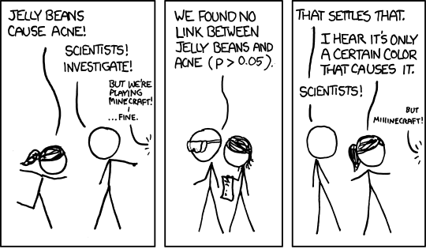
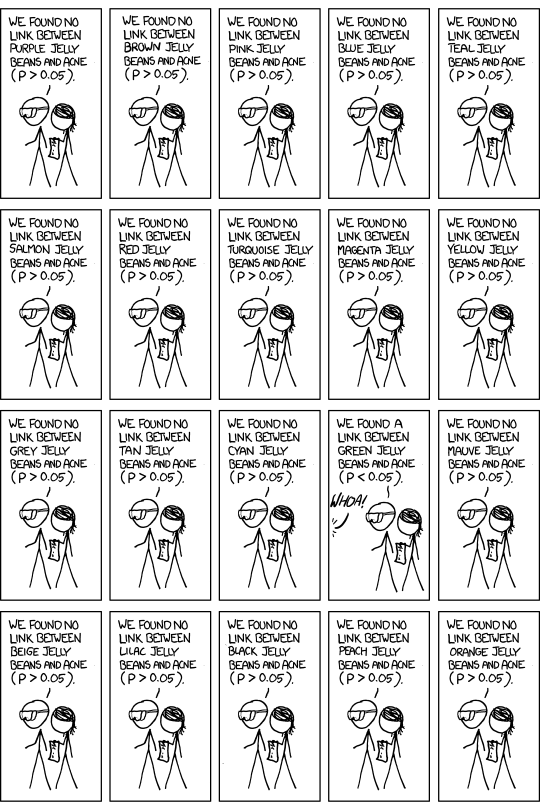

```{r setup, include = FALSE}
# Cartoons from https://github.com/allisonhorst/stats-illustrations
# dplyr based upon https://allisonhorst.shinyapps.io/dplyr-learnr/#section-welcome

source('../config.R')
options(width = 120, digits = 2)
```

class: center, middle, inverse, title-slide

# `r metadata$title`
## `r metadata$subtitle`
### `r metadata$author`
### `r metadata$date`


---

# Data Project Proposal

Due November 8<sup>th</sup> Select a dataset that interests you. For the proposal, you need to answer the questions below.

.font80[
* Research question
* What type of statistical test do you plan to do (e.g. t-test, ANOVA, regression, logistic regression, chi-squared, etc.)
* What are the cases, and how many are there?
* Describe the method of data collection.
* What type of study is this (observational/experiment)?
* Data Source: If you collected the data, state self-collected. If not, provide a citation/link.
* Response: What is the response variable, and what type is it (numerical/categorical)?
* Explanatory: What is the explanatory variable(s), and what type is it (numerical/categorical)?
* Relevant summary statistics
]

More information including template and suggested datasets located here: https://`r paste0(tolower(semester), year)`.data606.net/assignments/project/


---
# Family Treatment for Treating Anorexia

The following dataset in the `MASS` package was adapted from Hand, Daly, McConway, Lunn, and Ostrowski (1993). The dataset contains the pre- and post-weight for young females who were diagnosed with anorexia. There are three treatment levels in the full dataset, control, cognitive behavoural treatment, and family treatment. We will consider only the family treatment patients.

```{r, message=FALSE, warning=FALSE}
data('anorexia', package = 'MASS')
anorexia <- anorexia |> dplyr::filter(Treat == 'FT')
```

We have `r nrow(anorexia)` observations.

Research question: Is there a difference in the pre- and post-weights for the young females in the family treatment group?

---
# Family Treatment for Treating Anorexia

.pull-left[
```{r, fig.width=5, fig.height=4, eval=TRUE, message=FALSE, warning=FALSE}
anorexia.melt <- anorexia |> dplyr::select(Prewt, Postwt) |> reshape2::melt()
ggplot(anorexia.melt, aes(x=variable, y=value)) + 	
	geom_boxplot() + 
	geom_point(alpha=0.2, color='blue') +
	xlab('Test') + ylab('Score')
```
]
.pull-right[
```{r, fig.width=5, fig.height=4, eval=TRUE}
ggplot(anorexia.melt, aes(x=variable, y=value)) +
	ggdist::stat_halfeye() +
	geom_point(color='blue', 
			   position = position_nudge(x = -.05),
			   pch = '-', size = 5) + 
	xlab('Test') + ylab('Score')
```
]


---
# Analyzing Paired Data  

* When two sets of observations are not independent, they are said to be paired.
* To analyze these type of data, we often look at the difference.

```{r, fig.width=6, fig.height=4}
anorexia <- anorexia |> dplyr::mutate(diff = Postwt - Prewt)
```

```{r, eval=TRUE, fig.height=4}
ggplot(anorexia, aes(x = diff)) + 
	geom_histogram(aes(y = ..density..), bins = 6, color = 1, fill = 'white') + 
	geom_density(size = 2)
```


---
# Setting the Hypothesis

What are the hypothesis for testing if there is a difference between pre- and post-weights?

$H_0$: There is no difference between the pre- and post-weights.

$$\mu_{diff} = 0$$

$H_A$: There is a difference between the pre- and post-weights.

$$\mu_{diff} \ne 0$$

---
class: font120
# Nothing new here...

* The analysis is no different that what we have done before.

* We have data from one sample: differences.

* We are testing to see if the average difference is different that 0.


---
# Calculating the test-statistic and the p-value 

The observed average difference between the two weights is `r round(mean(anorexia$diff), digits = 2)` points and the standard deviation of the difference is `r round(sd(anorexia$diff), digits = 2)` points. Do these data provide convincing evidence of a difference between the average scores on the two exams (use $\alpha = 0.05$)?

```{r, fig.height = 5.5, echo=FALSE, warning=FALSE}
n <- nrow(anorexia)
meanDiff <- mean(anorexia$diff)
sdDiff <- sd(anorexia$diff)
seDiff <- sdDiff / sqrt(n)
zScore <- (meanDiff - 0) / seDiff
pValue <- pnorm(-1 * zScore) * 2
VisualStats::normal_plot(mean = 0, cv = c(-1 * abs(zScore), abs(zScore)), tails = 'two.sided')
```


---
# Calculating the test-statistic and the p-value 

$$Z = \frac{`r meanDiff` - 0}{ \frac{`r sdDiff`}{\sqrt{`r nrow(anorexia)`}} } = \frac{`r meanDiff`}{`r sqrt(nrow(anorexia))`} = `r zScore`$$
$$p-value = `r pValue / 2` \times 2 = `r pValue`$$

Since p-value < 0.05, we **reject the null hypothesis**. That is, the data do provide evidence that there is a statistically significant difference between pre- and post-weights.

```{r}
2 * pnorm(-1 * zScore, mean = 0, sd = 1)
```


---
# Evaluating the null hypothesis

## Interpretation of the p-value

The probability of obtaining a random sample of `r nrow(anorexia)` patients where the average difference between the pre- and post-weights is at least `r meanDiff` (in either direction), if in fact the true average difference between the score is 0, is < 0.01%.

--
## Calculating 95% Confidence Interval

```{r}
ciDiff <- c(meanDiff - 1.96 * seDiff, meanDiff + 1.96 * seDiff)
```

$$`r meanDiff`\pm 1.96\frac { `r sdDiff` }{ \sqrt { `r n` }  } =`r meanDiff`\pm 1.96\times `r seDiff`=(`r ciDiff[1]`, `r ciDiff[2]`)$$


Note that the confidence interval does not spans zero!

---
# Visualizing Dependent Sample Tests

```{r, results='hide', fig.height = 5.5}
VisualStats::dependent_sample_vis(anorexia[,c('Prewt', 'Postwt')])
```

.font70[Run `VisualStats::dependent_sample_shiny()` for the Shiny application.  
This visualizaiton was adapted from [Pruzek and Helmreich (2008)](https://github.com/jbryer/DATA606-2026-Fall/blob/master/resources/ElementalGraphicsForANOVA.pdf). ]


---
# SAT Scores by Sex

Is there a difference in math scores between males and females?

First we will load the data.

```{r}
data(sat, package = 'DATA606')
head(sat)
```

We need to convert the `Math.SAT` variable to an integer and drop any rows with missing values.

```{r, echo=FALSE, results='hide', warning=FALSE}
sat <- sat |>
	dplyr::mutate(Math.SAT = as.integer(Math.SAT)) |>
	tidyr::drop_na()
```


---
# SAT Scores by Sex 

.pull-left[
```{r}
tab <- describeBy(sat$Math.SAT, 
				  group = sat$Sex, 
				  mat = TRUE, skew = FALSE)
tab[,c(2,4:7)]
```
]

.pull-right[
```{r, fig.height=7}
ggplot(sat, aes(x = Sex, y = Math.SAT)) + 
	geom_boxplot() +
	geom_point(data = tab, aes(x=group1, y=mean), 
			   color='blue', size=4)
```
]

---
# Distributions  


```{r}
ggplot(sat, aes(x = Math.SAT, color = Sex)) + geom_density()
```

---
class: font120
# 95% Confidence Interval

We wish to calculate a 95% confidence interval for the average difference between SAT scores for males and females.

Assumptions:

1. Independence within groups.

2. Independence between groups.

3. Sample size/skew

---
# Confidence Interval for Difference Between Two Means

* All confidence intervals have the same form: point estimate ± ME
* And all ME = critical value * SE of point estimate
* In this case the point estimate is $\bar{x}_1 - \bar{x}_2$
Since the sample sizes are large enough, the critical value is z*
So the only new concept is the standard error of the difference between two means...

.pull-left[
Standard error for difference in SAT scores

$$SE_{ (\bar { x } _{ M }-\bar { x } _{ F }) }=\sqrt { \frac { { s }_{ M }^{ 2 } }{ { n }_{ M } } + \frac { { s }_{ F }^{ 2 } }{ { n }_{ F } }  }$$


$$SE_{ (\bar { x } _{ M }-\bar { x } _{ F }) } = \sqrt { \frac { 90.4 }{ 80 } +\frac { 103.7 }{ 82 }  } =1.55$$
]

.pull-right[
Calculate the 95% confidence interval:

$$(\bar{x}_{M} - \bar{x}_{F}) \pm 1.96 SE_{ (\bar { x } _{ M }-\bar { x } _{ F }) }$$
$$(626.9 - 597.7) \pm 1.96 \times 1.55$$
$$29.2 \pm 3.038 = (26.162, 32.238)$$

]

---
# Visualizing independent sample tests

```{r, echo = FALSE}
tab <- describeBy(sat$Math.SAT, group = sat$Sex, mat = TRUE)
names(tab)[2] <- 'Sex'
p_male <- ggplot(sat[sat$Sex == 'M',], aes(x = Math.SAT)) +
	geom_density(color = 'blue') +
	geom_vline(xintercept = tab[tab$Sex == 'M',]$mean, color = 'blue') +
	stat_function(geom = 'area',
				  fun = dnorm, 
				  args = list(mean = tab[tab$Sex == 'M',]$mean, 
				  			sd = tab[tab$Sex == 'M',]$se),
				  xlim = c(tab[tab$Sex == 'M',]$mean - tab[tab$Sex == 'M',]$se,
				  		   tab[tab$Sex == 'M',]$mean + tab[tab$Sex == 'M',]$se),
				  fill = 'blue', alpha = 0.5) +
	geom_function(fun = dnorm, 
				  args = list(mean = tab[tab$Sex == 'M',]$mean, 
				  			sd = tab[tab$Sex == 'M',]$se), 
				  color = 'blue') +
	ggtitle('Male') +
	xlim(c(400, 800))
p_female <- ggplot(sat[sat$Sex == 'F',], aes(x = Math.SAT)) +
	geom_density(color = 'purple') +
	geom_vline(xintercept = tab[tab$Sex == 'F',]$mean, color = 'purple') +
	stat_function(geom = 'area',
				  fun = dnorm, 
				  args = list(mean = tab[tab$Sex == 'F',]$mean, 
				  			sd = tab[tab$Sex == 'F',]$se),
				  xlim = c(tab[tab$Sex == 'F',]$mean - tab[tab$Sex == 'M',]$se,
				  		   tab[tab$Sex == 'F',]$mean + tab[tab$Sex == 'M',]$se),
				  fill = 'purple', alpha = 0.5) +
	geom_function(fun = dnorm, 
				  args = list(mean = tab[tab$Sex == 'F',]$mean, 
				  			sd = tab[tab$Sex == 'F',]$se), 
				  color = 'purple') +
	ggtitle('Female') +
	xlim(c(400, 800))
cowplot::plot_grid(p_male, p_female, ncol = 1)
```

---
# What about smaller sample sizes?

What if you want to compare the quality of one batch of Guinness beer to the next?

--

.pull-left[
* Sample sizes necessarily need to be small.
* The CLT states that the sampling distribution approximates normal as n -> Infinity
* Need an alternative to the normal distribution.
* The *t* distribution was developed by William Gosset (under the pseudonym *student*) to estimate means when the sample size is small.

Confidence interval is estimated using

$$\overline { x } \pm { t }_{ df }^{ * }SE$$

Where *df* is the degrees of freedom (*df* = *n* -1)
]

.pull-right[.center[

]]

---
# *t*-Distributions 

```{r, echo=FALSE}
x <- seq(-4, 4, length=100)
hx <- dnorm(x)

degf <- c(1, 3, 8, 30)
colors <- c("red", "blue", "darkgreen", "gold", "black")
labels <- c("df=1", "df=3", "df=8", "df=30", "normal")

plot(x, hx, type="l", lty=2, xlab="x value",
  ylab="Density", main="Comparison of t Distributions")

for (i in 1:4){
  lines(x, dt(x,degf[i]), lwd=2, col=colors[i])
}

legend("topright", inset=.05, title="Distributions", labels, lwd=2, lty=c(1, 1, 1, 1, 2), col=colors)
```

---
# *t*-test in R 

The `pt` and `qt` will give you the *p*-value and critical value from the *t*-distribution, respectively.

.pull-left[

Critical value for p = 0.05, degrees of freedom = 10

```{r}
qt(0.025, df = 10)
```

p-value for a critical value of 2, degrees of freedom = 10

```{r}
pt(2, df=10)
```

]
.pull-right[

The `t.test` function will calculate a null hyphothesis test using the *t*-distribution.

```{r}
t.test(Math.SAT ~ Sex, data = sat)
```


```{r, echo=FALSE, results='hide', message=FALSE, warning=FALSE}
require(ggplot2)
require(gdata)
require(psych)
require(granova)
require(granovaGG)
require(lattice)
library(VisualStats)
library(ggbeeswarm)

data(singer)
data(rat)
data(hand_washing, package = 'VisualStats')
```
]


---
class: inverse, middle, center
# Analysis of Variancne (ANOVA)


---
class: font90
# Analysis of Variance (ANOVA)

The goal of ANOVA is to test whether there is a discernible difference between the means of several groups.

**Hand Washing Example**

Is there a difference between washing hands with:  water only, regular soap, antibacterial soap (ABS), and antibacterial spray (AS)?

* Each tested with 8 replications
* Treatments randomly assigned

For ANOVA:

* The means all differ.
* Is this just natural variability?
* Null hypothesis:  All the means are the same.
* Alternative hypothesis:  The means are not all the same.

Source: De Veaux, R.D., Velleman, P.F., & Bock, D.E. (2014). *Intro Stats, 4th Ed.* Pearson.

---
# Boxplot

```{r, fig.height=6}
ggplot(hand_washing, aes(x = Method, y = Bacterial_Counts)) +  geom_boxplot() +
    geom_beeswarm(aes(color = Method)) + theme(legend.position = 'none')
```

---
class: font90
# Descriptive Statistics

```{r}
desc <- psych::describeBy(hand_washing$Bacterial_Counts, group = hand_washing$Method, mat = TRUE, skew = FALSE)
names(desc)[2] <- 'Method' # Rename the grouping column
desc$Var <- desc$sd^2 # We will need the variance latter, so calculate it here
desc
```

.pull-left[
```{r}
( k <- length(unique(hand_washing$Method)) )
( n <- nrow(hand_washing) )
```
]
.pull-right[
```{r}
( grand_mean <- mean(hand_washing$Bacterial_Counts) )
( grand_var <- var(hand_washing$Bacterial_Counts) )
( pooled_var <- mean(desc$Var) )
```
]

---
# Contrasts

A contrast is a linear combination of two or more factor level means with coefficients that sum to zero.

```{r}
desc$contrast <- (desc$mean - mean(desc$mean))
mean(desc$contrast) # Should be 0!
desc
```

---
# Plotting using contrasts

```{r, echo=FALSE}
anova_vis(Y = hand_washing$Bacterial_Counts, 
          group = hand_washing$Method,
          plot_boxplot = TRUE,
          plot_group_variances = FALSE,
          plot_group_sd = FALSE,
          plot_ms_within = FALSE,
          plot_ms_between = FALSE,
          plot_unit_line = FALSE,
          plot_grand_mean = FALSE,
          plot_sd_line = FALSE,
          plot_pooled_sd = FALSE,
          plot_between_group_variances = FALSE,
          ylab = 'Bacterial Counts'
)
```


---
# Grade Mean and Unit Line (slope = 1, intercept = $\bar{x}$)

```{r, echo = FALSE}
anova_vis(Y = hand_washing$Bacterial_Counts, 
          group = hand_washing$Method,
          plot_boxplot = FALSE,
          plot_group_variances = FALSE,
          plot_group_sd = FALSE,
          plot_ms_within = FALSE,
          plot_ms_between = FALSE,
          plot_unit_line = TRUE,
          plot_grand_mean = TRUE,
          plot_sd_line = FALSE,
          plot_pooled_sd = FALSE,
          plot_between_group_variances = FALSE,
          ylab = 'Bacterial Counts'
)
```


---
# Within Group Variance (error)

$$SS_{within} = \sum^{}_{k} \sum^{}_{i} (\bar{x}_{ik} -\bar{x}_{k} )^{2}$$
---
# Within Group Variance (error)


```{r, echo=FALSE}
anova_vis(Y = hand_washing$Bacterial_Counts, 
          group = hand_washing$Method,
          plot_boxplot = FALSE,
          plot_group_variances = TRUE,
          plot_group_sd = TRUE,
          plot_ms_within = FALSE,
          plot_ms_between = FALSE,
          plot_unit_line = TRUE,
          plot_grand_mean = TRUE,
          plot_sd_line = FALSE,
          plot_pooled_sd = FALSE,
          plot_between_group_variances = FALSE,
          ylab = 'Bacterial Counts'
)
```


---
# Within Group Variance (error)

```{r, echo=FALSE}
anova_vis(Y = hand_washing$Bacterial_Counts, 
          group = hand_washing$Method,
          plot_boxplot = FALSE,
          plot_group_variances = TRUE,
          plot_group_sd = TRUE,
          plot_ms_within = TRUE,
          plot_ms_between = FALSE,
          plot_unit_line = TRUE,
          plot_grand_mean = TRUE,
          plot_sd_line = FALSE,
          plot_pooled_sd = FALSE,
          plot_between_group_variances = FALSE,
          ylab = 'Bacterial Counts'
)
```


---
# Within Group Variance (error)

```{r, echo=FALSE}
anova_vis(Y = hand_washing$Bacterial_Counts, 
          group = hand_washing$Method,
          plot_boxplot = FALSE,
          plot_group_variances = FALSE,
          plot_group_sd = TRUE,
          plot_ms_within = TRUE,
          plot_ms_between = FALSE,
          plot_unit_line = TRUE,
          plot_grand_mean = TRUE,
          plot_sd_line = FALSE,
          plot_pooled_sd = TRUE,
          plot_between_group_variances = FALSE,
          ylab = 'Bacterial Counts'
)
```

---
# Between Group Variance

$$SS_{between} = \sum^{}_{k} n_{k}(\bar{x}_{k} -\bar{x} )^{2}$$


---
# Between Group Variance

```{r, echo=FALSE}
anova_vis(Y = hand_washing$Bacterial_Counts, 
          group = hand_washing$Method,
          plot_boxplot = FALSE,
          plot_group_variances = FALSE,
          plot_group_sd = TRUE,
          plot_ms_within = FALSE,
          plot_ms_between = FALSE,
          plot_unit_line = TRUE,
          plot_grand_mean = TRUE,
          plot_sd_line = FALSE,
          plot_pooled_sd = FALSE,
          plot_between_group_variances = TRUE,
          ylab = 'Bacterial Counts'
)
```


---
# Between Group Variance

```{r, echo=FALSE}
anova_vis(Y = hand_washing$Bacterial_Counts, 
          group = hand_washing$Method,
          plot_boxplot = FALSE,
          plot_group_variances = FALSE,
          plot_group_sd = TRUE,
          plot_ms_within = FALSE,
          plot_ms_between = TRUE,
          plot_unit_line = TRUE,
          plot_grand_mean = TRUE,
          plot_sd_line = FALSE,
          plot_pooled_sd = FALSE,
          plot_between_group_variances = FALSE,
          ylab = 'Bacterial Counts'
)
```

---
# Mean Square

| Source                  | Sum of Squares                                              | *df*  | MS                                   |
| ------------------------|:-----------------------------------------------------------:|:-----:|:------------------------------------:|
| Between Group (Treatment) | $\sum^{}_{k} n_{k}(\bar{x}_{k} -\bar{x} )^{2}$              | k - 1 | $\frac{SS_{between}}{df_{between}}$ 
| Within Group (Error)    | $\sum^{}_{k} \sum^{}_{i} (\bar{x}_{ik} -\bar{x}_{k} )^{2}$  | n - k | $\frac{SS_{within}}{df_{within}}$    |
| Total                   | $\sum_{n} ({x}_{n} -\bar{x} )^{2}$      | n - 1 |                                      |


---
# $MS_{Between} / MS_{Within}$ = F-Statistic

Mean squares can be represented as squares, hence the ratio of area of the two rectagles is equal to $\frac{MS_{Between}}{MS_{Within}}$ which is the F-statistic.

```{r, echo=FALSE, fig.height=6}
anova_vis(Y = hand_washing$Bacterial_Counts, 
          group = hand_washing$Method,
          plot_boxplot = FALSE,
          plot_group_variances = FALSE,
          plot_group_sd = TRUE,
          plot_ms_within = TRUE,
          plot_ms_between = TRUE,
          plot_unit_line = TRUE,
          plot_grand_mean = TRUE,
          plot_sd_line = FALSE,
          plot_pooled_sd = FALSE,
          plot_between_group_variances = FALSE,
          ylab = 'Bacterial Counts'
)
```


---
# Washing type all the same?

$H_0: \mu_1 = \mu_2 = \mu_3 = \mu_4$

Variance components we need to evaluate the null hypothesis:

* Between Sum of Squares: $SS_{between} = \sum^{}_{k} n_{k}(\bar{x}_{k} -\bar{x} )^{2}$

* Within Sum of Squares: $SS_{within} = \sum^{}_{k} \sum^{}_{i} (\bar{x}_{ik} -\bar{x}_{k} )^{2}$

* Between degrees of freedom: $df_{between} =  k - 1$ (k = number of groups)

* Within degrees of freedom: $df_{within} =  k(n - 1)$

* Mean square between (aka treatment): $MS_{T} = \frac{SS_{between}}{df_{between}}$

* Mean square within (aka error): $MS_{E} = \frac{SS_{within}}{df_{within}}$


```{r, eval=FALSE, echo=FALSE}
( ss_between <- sum(desc$n * (desc$mean - mean(hand_washing$Bacterial_Counts))^2) )
( ss_within <- sum((tmp$Bacterial_Counts - tmp$mean)^2) )
( ss_total <- sum((hand_washing$Bacterial_Counts - mean(hand_washing$Bacterial_Counts))^2) )
tmp <- merge(hand_washing, desc[,c('group1','mean')], by.x = 'Method', by.y = 'group1')
ss_between + ss_within == ss_total # Verify everything adds up
var(hand_washing$Bacterial_Counts) / 4
```


---
# Comparing $MS_T$ (between) and $MS_E$ (within)

.pull-left[
Assume each washing method has the same variance.

Then we can pool them all together to get the pooled variance ${ s }_{ p }^{ 2 }$

Since the sample sizes are all equal, we can average the four variances: ${ s }_{ p }^{ 2 } = `r prettyNum(mean(desc$Var), digits = 6)`$

```{r}
mean(desc$Var)
```
]

--

.pull-right[
$MS_T$

* Estimates ${ s }_{ p }^{ 2 }$ if $H_0$ is true
* Should be larger than ${ s }_{ p }^{ 2 }$ if $H_0$ is false

$MS_E$

* Estimates ${ s }_{ p }^{ 2 }$ whether $H_0$ is true or not
* If $H_0$ is true, both close to ${ s }_{ p }^{ 2 }$, so $MS_T$ is close to $MS_E$

Comparing

* If $H_0$ is true, $\frac{MS_T}{MS_E}$ should be close to 1
* If $H_0$ is false, $\frac{MS_T}{MS_E}$ tends to be > 1
]

---
class: font120
# The F-Distribution 

* How do we tell whether $\frac{MS_T}{MS_E}$ is larger enough to not be due just to random chance?

* $\frac{MS_T}{MS_E}$ follows the F-Distribution
	* Numerator df:  k - 1 (k = number of groups)
	* Denominator df:  k(n - 1)  
	* n = # observations in each group
	
* $F = \frac{MS_T}{MS_E}$ is called the F-Statistic.

A Shiny App by Dr. Dudek to explore the F-Distribution: <a href='https://shiny.rit.albany.edu/stat/fdist/' window='_new'>https://shiny.rit.albany.edu/stat/fdist/</a>

---
# The F-Distribution (cont.) 

```{r fdistribution, fig.width=10, fig.height=6, tidy=FALSE, eval=TRUE}
df.numerator <- 4 - 1
df.denominator <- 4 * (8 - 1)
DATA606::F_plot(df.numerator, df.denominator, cv = qf(0.95, df.numerator, df.denominator))
```


---
class: font120
# ANOVA Table


| Source                  | Sum of Squares                                              | *df*  | MS                                   | F                                   | p                              |
| ------------------------|:-----------------------------------------------------------:|:-----:|:------------------------------------:|:-----------------------------------:|--------------------------------|
| Between Group (Treatment) | $\sum^{}_{k} n_{k}(\bar{x}_{k} -\bar{x} )^{2}$              | k - 1 | $\frac{SS_{between}}{df_{between}}$  | $\frac{MS_{between}}{MS_{within}}$  | area to right of $F_{k-1,n-k}$ |
| Within Group (Error)    | $\sum^{}_{k} \sum^{}_{i} (\bar{x}_{ik} -\bar{x}_{k} )^{2}$  | n - k | $\frac{SS_{within}}{df_{within}}$    |                                     |                                |
| Total                   | $\sum_{n} ({x}_{n} -\bar{x} )^{2}$      | n - 1 |                                      |                                     |                                |


```{r}
aov(Bacterial_Counts ~ Method, data = hand_washing) |> summary()
```


---
# Assumptions and Conditions

* To check the assumptions and conditions for ANOVA, always look at  the side-by-side boxplots.
	* Check for outliers within any group.
	* Check for similar spreads.
	* Look for skewness.
	* Consider re-expressing.
	
* Independence Assumption
	* Groups must be independent of each other.
	* Data within each group must be independent.
	* Randomization Condition
	
* Equal Variance Assumption
	* In ANOVA, we pool the variances.  This requires equal variances from each group:  Similar Spread Condition.


---
# More Information

ANOVA Vignette in the `VisualStats` package: https://jbryer.github.io/VisualStats/articles/anova.html

The plots were created using the `VisualStats::anova_vis()` function.

Shiny app:

```{r, eval=FALSE}
# remotes::install_github('jbryer/VisualStats')
library(VisualStats)
VisualStats::anova_shiny()
```


---
class: font120
# What Next? 

* P-value large -> Nothing left to say
* P-value small -> Which means are large and which means are small?
* We can perform a t-test to compare two of them.
* We assumed the standard deviations are all equal.
* Use $s_p$, for pooled standard deviations.
* Use the Students t-model, df = N - k.
* If we wanted to do a t-test for each pair:
	* P(Type I Error) = 0.05 for each test.
	* Good chance at least one will have a Type I error.
* **Bonferroni to the rescue!**
	* Adjust a to $\alpha/J$ where J is the number of comparisons.
	* 95% confidence (1 - 0.05) with 3 comparisons adjusts to $(1 - 0.05/3) \approx  0.98333$.
	* Use this adjusted value to find t**.

---

```{r, echo=FALSE}

```

.font50[Source: https://xkcd.com/882/]

---

```{r, echo=FALSE, out.width='30%'}

```

.font50[Source: https://xkcd.com/882/]

---

```{r, echo=FALSE}

```

.font50[Source: https://xkcd.com/882/]

---
# Multiple Comparisons (no Bonferroni adjustment)

.code80[
```{r, fig.height=5, tidy=FALSE}
cv <- qt(0.05, df = 15)
tab <- describeBy(hand_washing$Bacterial_Counts, group = hand_washing$Method, mat = TRUE)
ggplot(hand_washing, aes(x = Method, y = Bacterial_Counts)) + geom_boxplot() + 
	geom_errorbar(data = tab, aes(x = group1, y = mean, 
								  ymin = mean - cv * se, ymax = mean + cv * se), 
				  color = 'darkgreen', width = 0.5, size = 1) +
	geom_point(data = tab, aes(x = group1, y = mean), color = 'blue', size = 3)
```
]

---
# Multiple Comparisons (3 paired tests)

.code80[
```{r, fig.height=5, tidy=FALSE}
cv <- qt(0.05 / 3, df = 15)
tab <- describeBy(hand_washing$Bacterial_Counts, group = hand_washing$Method, mat = TRUE)
ggplot(hand_washing, aes(x = Method, y = Bacterial_Counts)) + geom_boxplot() + 
	geom_errorbar(data = tab, aes(x = group1, y = mean, 
								  ymin = mean - cv * se, ymax = mean + cv * se), 
				  color = 'darkgreen', width = 0.5, size = 1) +
	geom_point(data = tab, aes(x = group1, y = mean), color = 'blue', size = 3)
```
]

---
# Multiple Comparisons (6 paired tests)

.code80[
```{r, fig.height=5, tidy=FALSE}
cv <- qt(0.05 / choose(4, 2), df = 15)
tab <- describeBy(hand_washing$Bacterial_Counts, group = hand_washing$Method, mat = TRUE)
ggplot(hand_washing, aes(x = Method, y = Bacterial_Counts)) + geom_boxplot() + 
	geom_errorbar(data = tab, aes(x = group1, y = mean, 
								  ymin = mean - cv * se, ymax = mean + cv * se ), 
				  color = 'darkgreen', width = 0.5, size = 1) +
	geom_point(data = tab, aes(x = group1, y = mean), color = 'blue', size = 3)
```
]


---
class: font90
# Tukey Honest Significant Differences

Tukey's Honestly Significant Difference (HSD) test is am alternative post-hoc test to Bonferroni that also controls the Type I error rate.

1. **Calculate the HSD Threshold**: The test computes a single minimum difference value (the HSD) needed for any two group means to be considered truly distinct.

	* Formula: $HSD = q \times \sqrt{\frac{MSE}{n}}$
	* $q$ is the value from the studentized range distribution based on the number of groups and error degrees of freedom.
MSE is the Mean Square Error from the ANOVA table.
	* $n$ is the sample size per group (or the harmonic mean if sample sizes are unequal, often called the [Tukey-Kramer method](https://en.wikipedia.org/wiki/Tukey%27s_B_method)). 

2. **Compare All Pairwise Means:** It finds the absolute difference between every pair of group means. 

3. **Make the Decision:** If the absolute difference between two means is greater than or equal to the HSD value (or if the adjusted *p*-value is less than $\alpha$), the pair is statistically significantly different. 

---
# Tukey Honest Significant Differences (in `r fontawesome::fa('r-project', fill = 'white')`)

```{r}
aov_out <- aov(Bacterial_Counts ~ Method, data = hand_washing)
TukeyHSD(aov_out)
```

Using this method we would conclude that alcholol spray is statistically significantly different to the other three hand washing techniques with $p < 0.05$.

---
class: left, font120
# One Minute Paper

.pull-left[
1. What was the most important thing you learned during this class?

2. What important question remains unanswered for you?
]
.pull-right[
```{r, echo=FALSE, fig.width=5, fig.height=5}
omp_link <- get_omp_link(
	course = course,
	semester = paste0(semester, year),
	topic = 'Inference for Numerical Data'
)
qrcode::qr_code(omp_link) |> plot(col = c('#FAFAFA', 'black'))
```
.center[.font50[[Scan the QR code or click here to  
complete the One Minute Paper](`r omp_link`)]]
]


